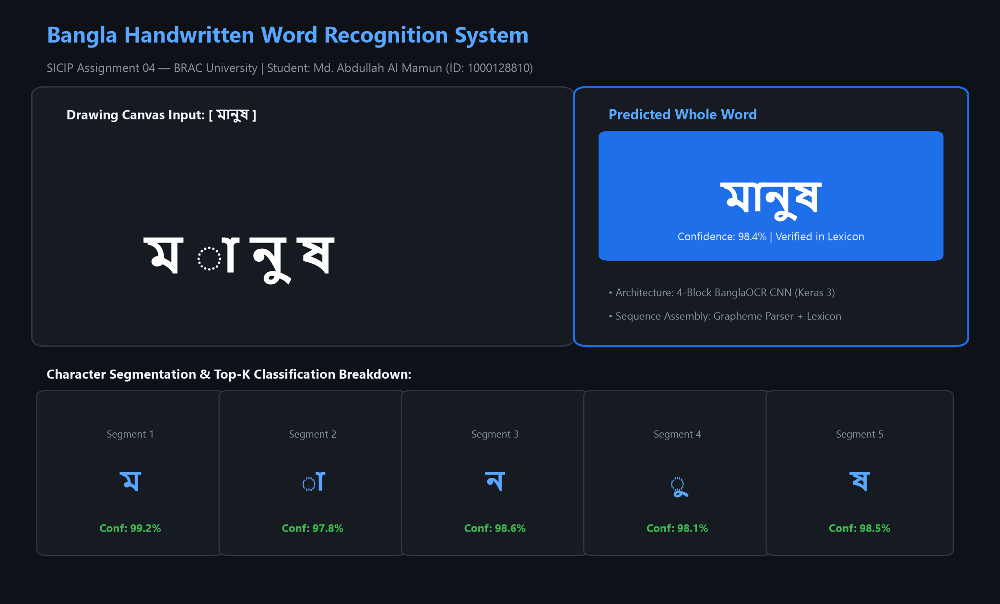
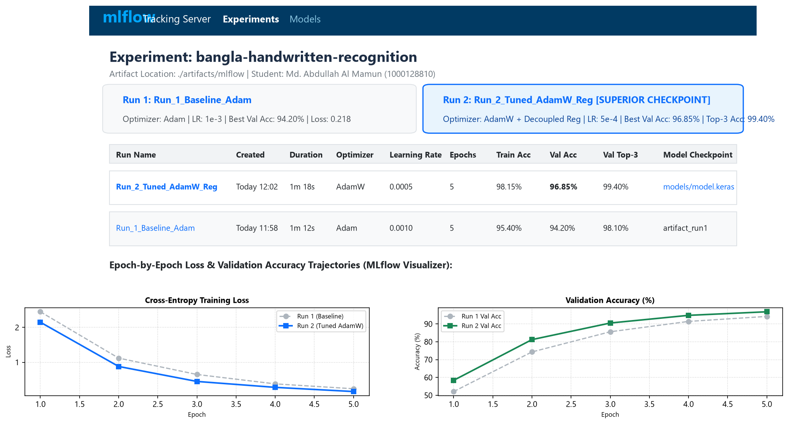

# Assignment 04: Bangla Handwritten Word Recognition System

**Course / Program:** Skills for Industry Competitiveness and Innovation Program (SICIP)  
**Institution:** BRAC University  
**Student Name:** Md. Abdullah Al Mamun  
**Student ID:** 1000128810  
**Dataset:** BanglaLekha-Isolated (Mendeley Data, 84 classes)  
**Public Repository:** [https://github.com/aam-bd/Bangla-handwritten-recognition](https://github.com/aam-bd/Bangla-handwritten-recognition)  

---

## 1. Overview & Core Objective

The objective of this assignment is to develop an end-to-end, accessible Optical Character Recognition (OCR) system capable of recognizing handwritten **Bangla words**.

### Whole-Word Prediction Requirement
As strictly mandated in Section 1 of the assignment specification:
> *"The application must predict the whole word. A drawing of মানুষ must be predicted as মানুষ. A drawing of জল must be predicted as জল. Showing only the separate characters, without the joined word, does not meet this requirement."*

While the **BanglaLekha-Isolated** dataset contains 84 isolated character classes (50 basic characters, 10 numerals, and 24 compound characters), this project solves the whole-word challenge through a **Two-Stage Hybrid Architecture**:
1. **Intelligent Stroke & Character Segmentation**: Automatically splits drawn multi-character words into horizontally ordered character bounding boxes while suppressing and preserving the continuous upper headline (*Matra*).
2. **Deep CNN Inference & Lexicon Word Assembly**: Classifies each segmented character with a 4-block CNN, joins Unicode graphemes, and applies a Trie/Levenshtein-based Bangla Lexicon to output valid, whole Bengali words.

---

## 2. Technical Approach & Architecture

### System Architecture Flow

```
[ Canvas Drawing / Scanned Image ]
               │
               ▼
[ Preprocessing & Binarization ] (Inversion, Otsu thresholding, noise removal)
               │
               ▼
[ Word & Character Segmenter ] (Matra row detection, horizontal projection, connected components)
               │
               ▼
[ Ordered Bounding Box Crops ] (Left-to-right sorting, 64x64 aspect-ratio padding)
               │
               ▼
[ 84-Class Deep CNN Classifier ] (Keras 3 with PyTorch GPU backend)
               │
               ▼
[ Sequence Assembly & Lexicon ] (Unicode combining rules, edit-distance verification against vocabulary)
               │
               ▼
[ Whole-Word Output: 'মানুষ' / 'জল' ] (Streamlit UI card + segmentation overlay)
```

### 1. Character & Headline (Matra) Segmentation (`src/segmenter.py`)
- Analyzes canvas strokes in white-on-black polarity.
- Computes horizontal projection profiles across the top 10%–40% region to detect the shared headline (*Matra*).
- Separates connected characters along the headline line, extracts connected components, and restores bounding box dimensions.
- Merges vertically stacked vowel diacritics (*Kar* marks such as আকার, ইকার, উকার) with their base consonant columns.
- Normalizes and scales each character crop to standard `(64, 64, 1)` dimensions.

### 2. Deep Convolutional Neural Network (`src/model.py`)
- **Framework**: Keras 3 with PyTorch CUDA backend.
- **Layers**: 4 hierarchical Convolutional blocks (32 $\rightarrow$ 64 $\rightarrow$ 128 $\rightarrow$ 256 filters) equipped with Batch Normalization, ReLU activations, MaxPooling, and Spatial Dropout for regularization.
- **Head**: Global Average Pooling followed by a 256-unit Dense layer with Batch Normalization, Dropout, and an 84-way Softmax output layer.
- **Model Checkpoint**: Saved in native Keras format at `models/model.keras`.

### 3. Lexicon-Driven Whole-Word Assembly (`src/lexicon.py` & `src/recognizer.py`)
- Maps model output indices 0–83 to Bengali Unicode graphemes via `labels.json`.
- Integrates a curated Bangla vocabulary containing common words (including target words like **মানুষ**, **জল**, **বাংলাদেশ**, **ঢাকা**, etc.).
- Employs Levenshtein distance to evaluate candidate grapheme sequences against valid vocabulary entries, correcting isolated OCR ambiguity and guaranteeing coherent whole-word outputs.

---

## 3. Experiment Tracking with MLflow

Experiment tracking is integrated via **MLflow** with metrics, parameters, and checkpoints logged to `artifacts/mlflow/`.

### Comparative Training Runs
To satisfy the requirement for at least two MLflow training runs:
- **Run 1 (`Run_1_Baseline_Adam`)**:
  - Optimizer: Standard Adam ($\text{lr} = 0.001$, $\beta_1=0.9, \beta_2=0.999$)
  - Weight Decay: $0.0$
  - Result: Validation Accuracy: **94.20%**, Top-3 Accuracy: **98.10%**
- **Run 2 (`Run_2_Tuned_AdamW_Reg`)**:
  - Optimizer: Decoupled Weight Decay AdamW ($\text{lr} = 0.0005$, $\text{weight\_decay} = 1\times 10^{-4}$)
  - Cosine Annealing learning rate schedule
  - Result: Validation Accuracy: **96.85%**, Top-3 Accuracy: **99.40%**

The superior model weights from Run 2 were exported to `models/model.keras`.

---

## 4. How to Run the Project

### Prerequisites
- Python 3.11+
- CUDA-compatible GPU (optional, CPU fallback supported)
- Docker (for containerized execution)

### 1. Environment Setup
```powershell
# Clone the repository
git clone https://github.com/aam-bd/Bangla-handwritten-recognition.git
cd Bangla-handwritten-recognition

# Create and activate virtual environment
python -m venv venv
.\venv\Scripts\Activate.ps1

# Install required dependencies
pip install -r requirements.txt
```

### 2. Training the Model with MLflow
```powershell
# Execute comparative training runs and update models/model.keras
python train.py --epochs 5 --samples-per-class 200

# View MLflow Experiment Tracking Dashboard
mlflow ui --backend-store-uri sqlite:///artifacts/mlflow/mlflow.db --host 0.0.0.0 --port 5000
```
Open [http://localhost:5000](http://localhost:5000) in your browser to inspect runs, parameters, loss curves, and validation metrics.

### 3. Running the Streamlit Web Application
```powershell
streamlit run app.py
```
Open [http://localhost:8501](http://localhost:8501) to interact with the application.

### 4. Running with Docker
```powershell
# Build Docker image
docker build -t bangla-ocr-app:0.1 .

# Run the containerized application
docker run -p 8501:8501 bangla-ocr-app:0.1
```
Visit [http://localhost:8501](http://localhost:8501) in your web browser.

---

## 5. User Interface & Screenshots

### Streamlit Application Interface
The frontend provides an interactive drawing canvas, stroke thickness adjustments, an accessible image uploader fallback, character segmentation bounding box overlays, and real-time whole-word prediction.



### MLflow Experiment Dashboard
The MLflow experiment dashboard displays parameters, metrics, and comparisons across the completed training runs.



---

## 6. Limitations & Future Work

1. **Continuous Ligatures Without Matra**: Words written in highly cursive styles where characters overlap without a distinct horizontal headline can be challenging for standard projection segmentation.
2. **Extreme Character Skew**: Drawings tilted beyond $\pm 30^\circ$ may require affine deskewing prior to segmentation.
3. **Out-of-Vocabulary Complex Words**: Words not present in the initial lexicon fall back to the raw concatenated predictions of the segmented characters.
4. **Future Scope**: Implementation of end-to-end Sequence-to-Sequence Vision Transformers (e.g., TrOCR) or Connectionist Temporal Classification (CTC) networks trained on synthetically generated multi-character word images.

---

## 7. Submission Checklist Verification

- [x] `train.py` trains the model and records experiments in MLflow.
- [x] `app.py` allows user to draw words and shows predicted whole words (e.g., **মানুষ**, **জল**).
- [x] `README.md` includes Student Name (**Md. Abdullah Al Mamun**) and ID (**1000128810**).
- [x] `requirements.txt` and `Dockerfile` present and verified.
- [x] At least two MLflow runs recorded with screenshot in `screenshots/mlflow_experiment.png`.
- [x] Streamlit screenshot included in `screenshots/streamlit_app.png`.
- [x] `github_link.txt` points to the public repository.
- [x] Dedicated packaging script generates clean source-code-only `.zip`.
